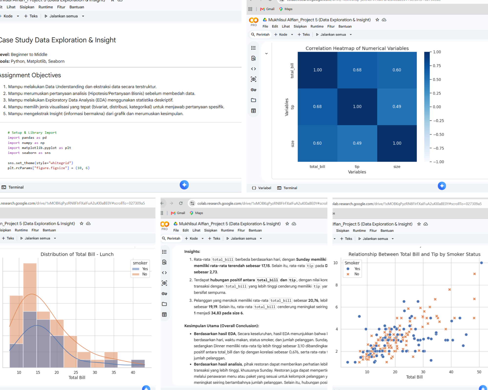

# Python Data Exploration & Insights — Restaurant Transaction Analysis

## Project Overview
This project explores restaurant transaction data to understand customer spending behavior and tipping patterns using Python. The analysis focuses on transaction values, tips, dining periods, customer groups, and other relevant factors.

## Objectives
- Understand the characteristics of restaurant transactions.
- Explore the relationship between total bills and tips.
- Compare spending patterns across days and dining periods.
- Identify insights that may support restaurant business decisions.

## Dataset
The project uses the Seaborn `tips` dataset, containing 244 observations and 7 columns:
- `total_bill`
- `tip`
- `sex`
- `smoker`
- `day`
- `time`
- `size`

## Tools & Technologies
- Python
- Pandas
- NumPy
- Matplotlib
- Seaborn
- Google Colab

## Analysis Process
1. Data loading and understanding.
2. Data quality checking and missing-value inspection.
3. Descriptive statistical analysis.
4. Exploratory Data Analysis (EDA).
5. Data visualization and interpretation.
6. Business insights and recommendations.

## Key Findings
- Sunday had the highest average total bill, approximately 21.41, while Friday had the lowest, approximately 17.15.
- Average tips during dinner were approximately 3.10, compared with 2.73 during lunch.
- Total bill and tip showed a positive correlation of approximately 0.676.
- Customers recorded as smokers had an average total bill of approximately 20.76, compared with 19.19 for non-smokers.

## Business Recommendations
- Use transaction data to evaluate customer spending patterns across days and dining periods.
- Consider targeted promotions during periods with lower average transaction values.
- Explore how bill size and group size relate to tipping behavior.
- Treat the findings as exploratory insights rather than evidence of causal relationships.

## Notebook
[Open the Python analysis in Google Colab](https://colab.research.google.com/drive/1xMOBKqPyzRN8FIrFXaIFuA2uKI0aBE0Y)

## Analysis Visualizations

## Conclusion
This project demonstrates the use of Python for data exploration, statistical summaries, visualization, and business insight generation.
